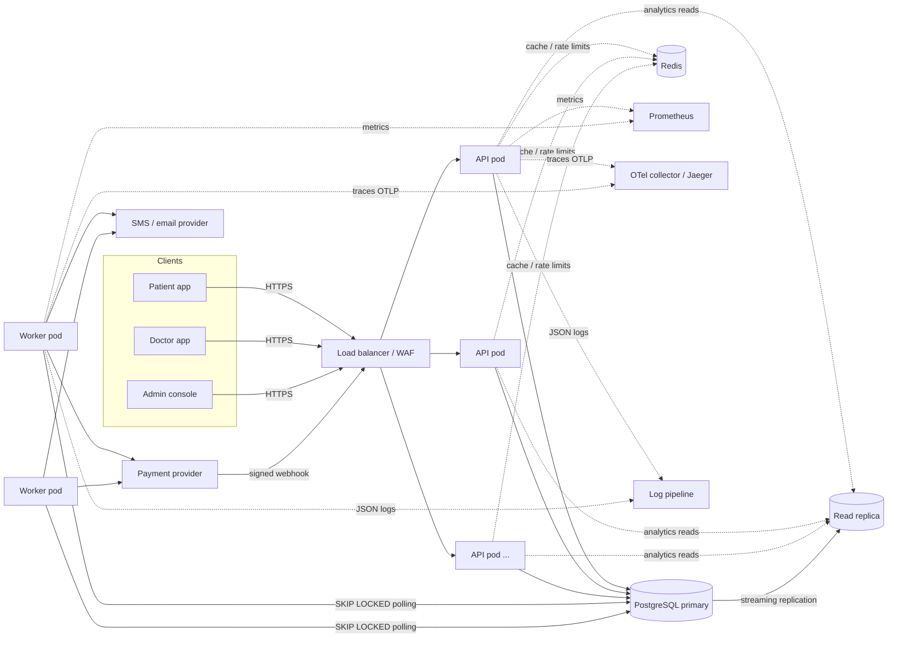
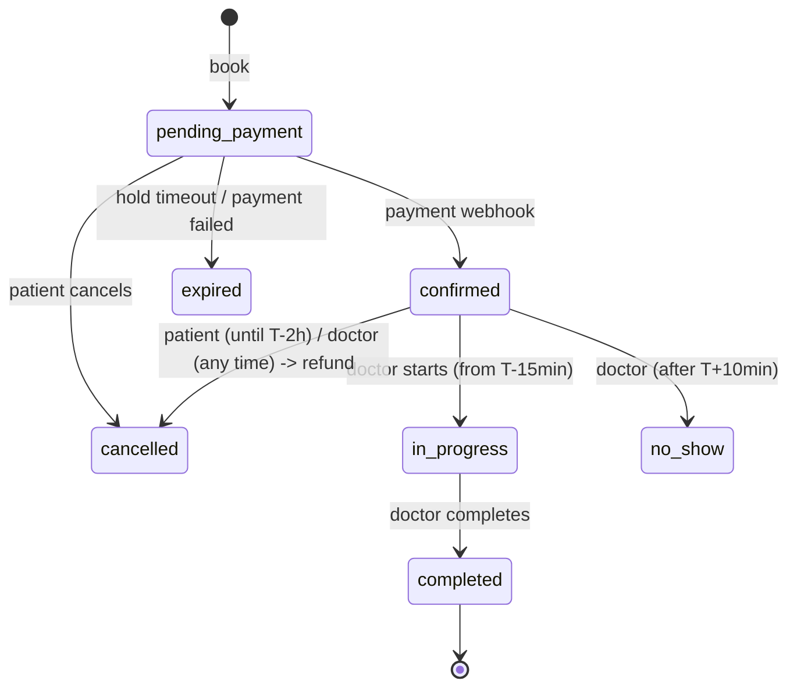
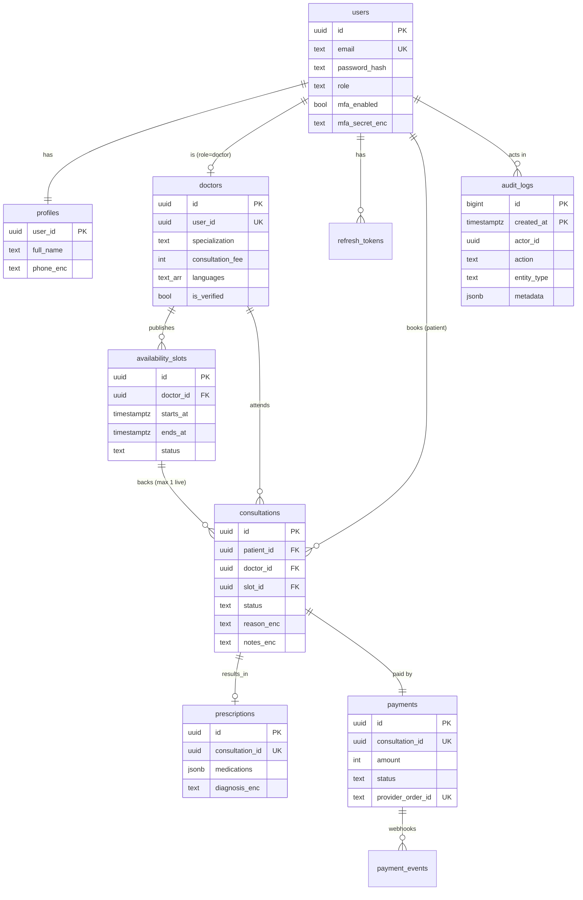

# Architecture

This document covers how the backend is put together, how the booking flow stays correct under load, and how the system is expected to scale to roughly 100k consultations a day.

## 1. High level architecture



There are two deployables built from the same image:

- **api**: stateless Express app. It scales horizontally behind the load balancer (HPA on CPU, at least 3 replicas spread across zones).
- **worker**: runs background jobs from a Postgres-backed queue: payment-hold expiry, refunds, notifications, analytics rollups and maintenance. You can run as many workers as you like because jobs are claimed with `FOR UPDATE SKIP LOCKED`.

PostgreSQL is the source of truth. Redis is optional: it holds caches and rate-limit counters, and the system keeps working (a bit slower) if Redis goes down.

### Code layout

```
src/
  config/        env parsing + validation (fails fast on boot)
  db/            pg pool, transaction helper with retry, migrator
  lib/           crypto, totp, cache, metrics, tracing, retry, logger
  middlewares/   auth, validation, idempotency, rate limiting, errors
  modules/<x>/   <x>.service.js (business logic) + <x>.routes.js (HTTP)
  jobs/          queue + job handlers + recurring schedule
  container.js   dependency injection: builds every service by hand
```

Each service is a factory, for example `createConsultationsService({ db, cipher, audit, queue, config, ... })`. `container.js` wires them all together. The tests use the same container and swap in a fake notifier, and you could swap the payment provider the same way. There's no DI framework: plain function arguments keep it obvious what depends on what.

### Data flow of a request

1. `requestContext` assigns or propagates `x-request-id`. It's included in every log line, every audit row and every error response.
2. pino-http logs the request. Auth headers and PHI fields are redacted.
3. Rate limiter (per IP, plus per user on authenticated routes).
4. JWT authentication, then a role check (and for admins, an MFA check).
5. zod validation of params, query and body.
6. Idempotency middleware for booking, cancellation and prescription writes.
7. The service runs the business logic inside a DB transaction. Audit rows and outbox jobs are written **in the same transaction**.
8. The error handler maps everything to `{ error: { code, message, details, requestId } }`.

## 2. Booking flow

Booking is the most important flow. It's a small saga with three steps: hold the slot, take payment, then confirm. A timeout and refunds act as compensating actions.

```mermaid
sequenceDiagram
  autonumber
  participant P as Patient
  participant API
  participant DB as Postgres
  participant Q as Job queue (jobs table)
  participant W as Worker
  participant PSP as Payment provider

  P->>API: POST /consultations {slotId} + Idempotency-Key
  API->>DB: claim idempotency key (INSERT ... ON CONFLICT)
  API->>DB: BEGIN
  API->>DB: SELECT slot FOR UPDATE
  alt slot not open
    API-->>P: 409 SLOT_UNAVAILABLE
  end
  API->>DB: slot -> held (held_until = now + 10m)
  API->>DB: INSERT consultation (pending_payment)
  API->>DB: INSERT payment (pending, order id)
  API->>Q: enqueue booking.expire_hold at held_until
  API->>DB: INSERT audit_log
  API->>DB: COMMIT
  API->>DB: store response against idempotency key
  API-->>P: 201 {consultation, payment.orderId, payBefore}

  P->>PSP: pays using orderId
  PSP->>API: POST /payments/webhook (HMAC signed)
  API->>DB: BEGIN; INSERT payment_events(event_id) ON CONFLICT DO NOTHING
  alt duplicate event
    API-->>PSP: 200 duplicate
  else consultation still pending
    API->>DB: payment succeeded, consultation confirmed, slot booked
    API->>Q: enqueue notify.booking_confirmed
  else hold already expired / cancelled
    API->>DB: payment refund_pending
    API->>Q: enqueue payments.refund
  end
  API->>DB: COMMIT
  API-->>PSP: 200

  Note over W,Q: if no payment arrives in time
  W->>Q: claim booking.expire_hold
  W->>DB: consultation expired, slot open, payment cancelled
```

Consultation states:



Transitions are defined in one place (`consultation.state.js`) and unit tested. The services refuse anything not on that list with `409 INVALID_STATUS_TRANSITION`.

## 3. ER diagram



Supporting tables: `idempotency_keys`, `jobs` (queue/outbox), `payment_events` (webhook dedupe), `daily_stats` (analytics rollups), `schema_migrations`.

Money is stored as integer paise, never as floats. All timestamps are `timestamptz` and the DB session runs in UTC. Local time (IST) only matters for "which day" questions such as search by day and daily stats.

## 4. API

REST, versioned under `/api/v1`. The full schema is in [`openapi.yaml`](./openapi.yaml), served as Swagger UI at `/docs`.

| Area | Endpoints |
| --- | --- |
| Auth | `POST /auth/register, /login, /login/mfa, /refresh, /logout, /mfa/setup, /mfa/enable, /mfa/disable` |
| Users | `GET/PATCH /users/me` |
| Doctors | `GET /doctors` (search), `GET /doctors/:id`, `GET /doctors/:id/slots`, `PUT /doctors/me`, `POST /doctors/me/slots`, `DELETE /doctors/me/slots/:id` |
| Consultations | `POST /consultations`, `GET /consultations`, `GET /consultations/:id`, `POST /:id/cancel, /:id/start, /:id/complete, /:id/no-show` |
| Prescriptions | `POST/GET /consultations/:id/prescription`, `GET /prescriptions` |
| Payments | `POST /payments/webhook` |
| Admin | `GET /admin/analytics/overview, /analytics/daily, /audit-logs, /jobs/failed`, `PATCH /admin/doctors/:id/verification, /users/:id/status`, `POST /admin/jobs/:id/retry` |

## 5. Retry and backoff

There are three layers, each with its own reason to exist:

| Where | What is retried | Strategy |
| --- | --- | --- |
| `db.transaction()` | serialization failures (`40001`) and deadlocks (`40P01`) | up to 3 retries of the **whole** transaction, exponential backoff from 20ms with full jitter |
| Outbound calls (payment provider refund) | errors marked `retryable` (timeouts, 5xx) | 3 in-process retries, base 200ms, full jitter, plus a provider idempotency key so a retry can't double refund |
| Job queue | any failed job | `attempts` counter, re-queued with `run_at = now + rand(0, 2s * 2^attempt)` capped at 10 min. After `max_attempts` (default 5) the job goes to `failed` (dead letter). It's visible at `/admin/jobs/failed`, raises an alert, and can be retried from the API. |

Client-side retries are made safe by `Idempotency-Key`. A client can retry a booking after a timeout and either get the original response back or a `409 REQUEST_IN_PROGRESS`. It can never create a second booking. If a key is reused with a different body, the request is rejected with 422. Server errors (5xx) release the key so the client can try again.

We use full jitter (rather than plain exponential) so that a burst of failures, for example after a provider blip, doesn't turn into synchronized retry waves.

## 6. Data partitioning

Rough numbers at the target scale:

- 100k consultations a day is about 36M a year. That also means about 100k payments, a few hundred thousand slots a day, and audit rows at roughly 10 per consultation (about 1M a day, around 365M a year).

Approach:

- **audit_logs** is range partitioned by month (`created_at`). Partitions are created ahead of time by a daily maintenance job (`ensure_audit_partition`). Old partitions can be detached and archived to S3/Glacier as a unit, which suits a compliance retention policy, and queries filtered by date only touch the relevant partitions. A `DEFAULT` partition catches anything that arrives before its partition exists.
- **consultations / payments / availability_slots** stay unpartitioned for now. A few tens of millions of rows with the right composite indexes (`(patient_id, scheduled_start)`, `(doctor_id, scheduled_start)`, partial `WHERE status = 'open'` on slots) is comfortable for Postgres. The next step when they grow is monthly range partitioning on `scheduled_start` / `starts_at`, the same pattern as audit_logs.
- **jobs, idempotency_keys, refresh_tokens** are kept small by the hourly `maintenance.cleanup` job, so they never need partitioning.
- **Horizontal sharding** is not needed at this scale. If it ever is, the natural shard key is `doctor_id`, because slots, consultations and most writes are scoped to a doctor. Patient-centric reads would then go through a lookup or read model.
- **Read scaling**: analytics and search can be pointed at a read replica. Search and profile reads are also cached.

## 7. Caching and concurrency

**Caching (Redis, falls back to in-memory):**

| Key | TTL | Invalidation |
| --- | --- | --- |
| `doctors:search:<hash of filters>` | 30s | prefix delete on profile change, slot changes, verification, bookings |
| `doctors:profile:<id>` | 120s | deleted on profile update / verification |
| `analytics:overview:<from>:<to>` | 60s | TTL only (slightly stale numbers are fine) |
| `rl:*` | window | rate-limit counters |

Slot lists are **not** cached. They change on every booking, and a stale "open" slot would only lead to a 409 on booking anyway. They're served straight from a partial index.

Cache failures are swallowed and logged, so a Redis outage only costs latency.

**Concurrency control:**

- **Double booking**: the booking transaction does `SELECT ... FOR UPDATE` on the slot row, so concurrent attempts on the same slot queue up and only the first sees `open`. As a backstop, a partial unique index `consultations(slot_id) WHERE status NOT IN ('cancelled','expired')` makes a second live booking impossible even if a code path forgets the lock. The test suite fires 5 concurrent bookings at one slot and asserts exactly one 201.
- **Overlapping slots**: slot creation takes a per-doctor `pg_advisory_xact_lock`, then checks for overlap. Two parallel "create slots" requests from the same doctor can't both pass the check.
- **Webhooks vs expiry job**: both lock the payment and consultation rows (`FOR UPDATE`) and re-check status inside the transaction. Whichever runs second sees the new state and takes the compensating path, for example a late payment gets refunded.
- **Refresh token rotation** locks the token row, so two parallel refreshes can't both succeed.
- **Jobs**: `FOR UPDATE SKIP LOCKED` hands each job to exactly one worker. Jobs stuck in `running` (worker crashed) are re-queued after 5 minutes. Handlers are written to be idempotent because a job can run twice in that case.
- **Migrations** take an advisory lock, so multiple pods starting at once don't race.

## 8. Transactions and sagas

- Every state change and its audit row commit together. If the audit insert fails, the change rolls back.
- **Transactional outbox**: side effects (notifications, refunds, expiry timers) are written to the `jobs` table inside the same transaction as the change that caused them. A job therefore exists if and only if the change committed. No job is ever lost, and no notification is ever sent for a rolled-back booking.
- **Booking saga**:

| Step | Action | Compensation |
| --- | --- | --- |
| 1 | Hold slot, create consultation + pending payment | `booking.expire_hold` job releases the slot if step 2 doesn't happen in 10 minutes |
| 2 | Provider captures payment (external) | `payment.failed` webhook releases the slot immediately |
| 3 | Webhook confirms consultation, books slot | If step 3 finds the hold already expired, the payment is refunded (`payments.refund`) |
| Later | Cancellation | refund job for paid bookings; slot reopened (patient cancel) or blocked (doctor cancel) |

- External calls (payment provider) are never made while holding DB locks. The refund job reads, calls the provider, then updates in a short transaction guarded by `WHERE status = 'refund_pending'`.
- The default isolation is READ COMMITTED with explicit row locks where it matters. That's cheaper than SERIALIZABLE everywhere, and every critical section is covered by a lock or a unique constraint.

## 9. Backup and disaster recovery

Targets: **RPO 5 minutes, RTO 1 hour** for a full region loss. Inside a region, a single AZ or instance failure is handled automatically within minutes.

- **Postgres**: managed Postgres (RDS/Aurora or Cloud SQL) with Multi-AZ synchronous standby. Automatic failover takes about 1 to 2 minutes, and the API reconnects through the pool. That failover is what keeps us inside the 99.95% budget (about 22 minutes of downtime a month).
  - Continuous WAL archiving / PITR with 35 days retention.
  - Daily snapshots copied cross-region, encrypted with a KMS key in the DR region.
  - Cross-region read replica in the DR region. It gets promoted in a regional disaster.
- **Redis** holds nothing that can't be rebuilt (cache + counters), so it isn't backed up.
- **Audit logs**: monthly partitions older than the hot window are exported to S3 with Object Lock (WORM) for the compliance retention period (assumed 7 years for medical records), then detached.
- **App and config**: images live in a registry with immutable tags; manifests live in git (`infra/k8s`). The DR cluster can be brought up from git. Secrets are replicated in Secrets Manager.
- **Drills**: a quarterly restore test restores the latest snapshot into a scratch environment, runs migrations and the integration suite against it, and records the actual RTO.
- **Runbook (region loss)**: promote the DR replica, point the `DATABASE_URL` secret at it, scale up the DR cluster, switch DNS / global load balancer. Payment webhooks that failed during the outage are retried by the provider, and the `payment_events` dedupe makes those retries safe.

## 10. Meeting the non-functional targets

| Target | How |
| --- | --- |
| 100k consultations/day | That's about 1.2 bookings/s on average, maybe 20 to 30/s at peak. Writes are short, single-row-locked transactions. Search is cached. Reads (slots, my consultations) hit composite or partial indexes. 3 API pods handle this with a lot of headroom; the HPA covers spikes. |
| p95 < 200ms reads | indexed queries only, no N+1 (joins in one query), cache on search and profiles, `statement_timeout` 5s to kill runaway queries. The `http_request_duration_seconds` histogram per route has an alert on p95. |
| p95 < 500ms writes | booking is ~6 statements in one transaction. Slow work (notifications, refunds, analytics) is pushed to jobs. |
| 99.95% availability | ≥3 replicas across AZs, PDB, rolling deploys with `maxUnavailable: 0`, readiness probe on DB, graceful shutdown, Multi-AZ Postgres, Redis is optional, burn-rate alert on the error budget. |
| Security | see [security.md](./security.md) |
| Observability | JSON logs with request id, Prometheus metrics + alerts, OpenTelemetry traces (HTTP, Express, pg auto-instrumented). |
